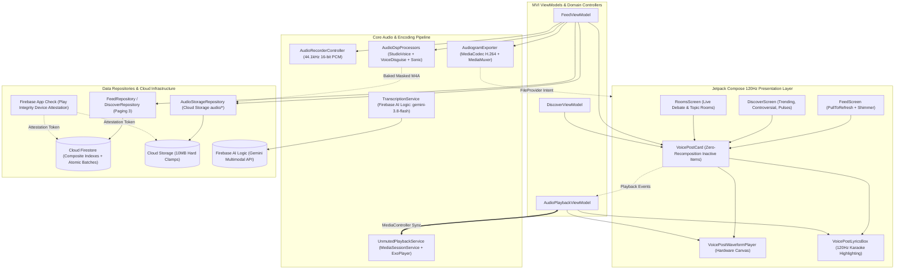

<div align="center">

# 🎙️ Unmuted

**Voice-first social platform built for unfiltered debate, true voice anonymity, and synchronized karaoke captions.**

[](https://kotlinlang.org)
[](https://developer.android.com/jetpack/compose)
[](https://m3.material.io)
[](https://developer.android.com/media/media3)
[](https://firebase.google.com)
[](https://developer.android.com/build)
[](https://developer.android.com/about/versions/16)
[](LICENSE)

[Architecture Guide](docs/ARCHITECTURE.md) • [Security & Privacy](SECURITY.md) • [Setup Guide](#local-development--setup) • [Testing](#testing-suite)

</div>

---

## ⚡ Highlights

Unmuted reimagines voice social networking. Rather than ephemeral audio drop-in rooms that disappear when closed or compressed voice memos lost in chat apps, Unmuted pairs **high-fidelity asynchronous voice broadcasting** with **true biometric voice privacy**, **real-time AI transcription**, and **hardware-accelerated audiogram exports**.

- **🎤 Studio Voice Polish**: Live on-device DSP chain with an 80Hz Butterworth rumble filter, RMS automatic gain control (-16 dBFS target), soft-knee `tanh` compression, and -1 dBFS peak limiting.
- **🔒 True Anonymous Rooms**: Cryptographically secure identity isolation. Masked voice audio is destructively baked on-device, and public documents are detached from user identities via per-user 32-byte salts, room-scoped hashes, and atomic Firestore `getAfter()` ownership verification.
- **📝 Synchronized Karaoke Captions**: Word- and phrase-level timestamped transcriptions powered by Firebase AI Logic (`gemini-3.8-flash`), highlighted at 120Hz alongside an interactive Canvas waveform scrubber.
- **🎬 9:16 Audiogram Video Export**: Built-in Android `MediaCodec` rendering pipeline that burns audio, animated waveforms, speaker avatars, and karaoke captions into 720x1280 @ 30fps vertical MP4 videos ready for Instagram Stories, WhatsApp Status, and YouTube Shorts.
- **📻 Hands-Free Radio Mode**: Media3 `MediaSessionService` playback engine with system Audio Focus ducking, `BecomingNoisyReceiver` auto-pausing, notification lock-screen controls, and continuous background playlist queueing.

---

## 🏗️ System Architecture



For full architectural diagrams, package breakdowns, and memory layout specs, see the **[Architecture Documentation](docs/ARCHITECTURE.md)**.

---

## 🎯 Core Features

### 1. Threads/X-Style Audio Feed & Indexed Discover
- **60-Second Voice Pulses**: High-impact, bite-sized spoken audio with voice comments and clapback debates.
- **Discovery Engine**:
  - **Trending**: Hacker News-style gravity formula prioritizing fresh, highly engaged voice posts ($Score = (U - D) / (T + 2)^{1.5}$).
  - **Controversial**: Surfaces debates with balanced upvote/downvote parity.
  - **Anonymous Takes**: Dedicated stream for candid, whistleblower, and unfiltered viewpoints.
  - **Short Pulses**: Rapid-fire takes under 15 seconds.
  - **Tokenized Search**: Real-time hashtag and keyword search via Firestore `searchTokens` array-contains indexing.

### 2. Spotify-Style Synchronized Captions
- **Multimodal AI Transcription**: Voice recordings are transcribed via Firebase AI Logic (`gemini-3.8-flash`) returning precise start and end millisecond timestamps for each word or phrase.
- **Monotonic Fallback Engine**: If network latency spikes or offline mode is active, an automated monotonic timestamp fallback generator distributes text phrases evenly across the duration to guarantee uninterrupted UI synchronization.
- **Interactive Karaoke Display**: Words highlight dynamically in sync with the playback cursor. Tapping any word scrubs playback directly to that exact millisecond.

### 3. True Anonymous Rooms & Cryptographic Isolation
- **Fail-Closed Destructive Masking**: Audio is destructively processed on-device (pitch transposition, 8-bit quantization, 45Hz ring modulation). If DSP masking fails, upload aborts immediately—raw audio is **never** uploaded.
- **Cryptographic Salt**: Each user holds a secret 32-byte hex salt in `users/{uid}/private/anon_salt` locked by security rules against client enumeration.
- **Room-Scoped Pseudonyms**: Anonymous IDs are computed as `"anon_" + sha256(userSalt + ":" + roomId).take(16)`, making it mathematically impossible to link a user across rooms or reverse their identity.
- **Atomic Ownership Dual-Write**: Posts are committed in an atomic `WriteBatch` alongside a private `anonymous_ownership/{postId}` document. Firestore rules use `getAfter()` to verify author ownership during deletion without exposing the real UID on the public document.

### 4. Hands-Free Radio Mode & Lock Screen Controls
- **Android MediaSessionService**: Playback runs as a first-class foreground service (`UnmutedPlaybackService`) powered by Media3 ExoPlayer.
- **Audio Focus & Headset Integration**: Native `USAGE_MEDIA` and `CONTENT_TYPE_SPEECH` attributes ensure smooth ducking during incoming calls or navigation alerts, with automatic pausing via `BecomingNoisyReceiver` when headphones disconnect.
- **Continuous Playlist Queue**: With Radio Mode toggled, the active feed automatically queues up next posts as native `MediaItem` entries, enabling continuous playback and lock-screen/Bluetooth Next and Previous skip controls.

### 5. On-Device 9:16 Vertical Audiogram Video Export
- **Hardware-Accelerated Encoding**: Zero cloud rendering dependencies. Video frames are drawn to an input `Surface` and encoded into H.264 via Android's `MediaCodec` (720x1280 @ 30fps, 3.5 Mbps, `KEY_MAX_B_FRAMES = 0`).
- **Monotonic Presentation Timestamps (PTS)**: Explicit synthetic PTS calculations guarantee 1:1 audio-video synchronization without wall-clock drift.
- **Lossless AAC Passthrough**: Audio packets are extracted directly from the post container and multiplexed via `MediaMuxer` without lossy re-encoding.
- **1-Tap Social Sharing**: Exported files are served via `androidx.core.content.FileProvider` directly to Instagram Stories, WhatsApp Status, and YouTube Shorts.

### 6. Real-Time Direct Voice Messaging
- **Direct Voice Memos**: Asynchronous private voice messaging with live amplitude previews and duration metering.
- **Participant-Bound Storage**: Cloud Storage rules strictly isolate voice files under `audio/dms/{convId}/{msgId}` to verified conversation participants.

### 7. 120Hz Jetpack Compose Polish
- **Zero-Recomposition Inactive Cards**: Pass progress providers (`playbackPositionMsProvider: () -> Long`) instead of raw primitives so inactive cards are skipped completely during playback ticks.
- **Single-Pass Waveform Canvas**: Normalized waveform bars are rendered in a single hardware-accelerated Canvas draw pass, eliminating thousands of Compose layout nodes.
- **Material 3 Shimmer & Pull-to-Refresh**: Clean skeleton placeholders (`VoicePostSkeleton`) and fluid pull-to-refresh integration.

---

## 🛠️ Tech Stack & Dependencies

All dependencies match exact versions defined in [gradle/libs.versions.toml](gradle/libs.versions.toml):

| Component | Library / Framework | Version | Purpose |
| :--- | :--- | :--- | :--- |
| **Language** | Kotlin | `2.4.21` | Modern, coroutine-first language |
| **Build System** | Android Gradle Plugin (AGP) | `9.1.1` | Android build and resource packaging |
| **Compilation** | Target / Compile SDK | `36` (Android 16 preview) | Latest Android APIs (Min SDK: 24) |
| **UI Toolkit** | Jetpack Compose (BOM) | `2024.09.00` | Declarative UI framework |
| **Design System** | Compose Material 3 | `1.3.0` | Material 3 themes, shapes, color schemes |
| **Audio & Video** | AndroidX Media3 (ExoPlayer + Transformer) | `1.5.1` | Audio playback, custom DSP audio processors, audio transcoding |
| **Video Hardware**| Android `MediaCodec` + `MediaMuxer` | API Native | On-device 9:16 vertical MP4 video rendering |
| **Backend & Auth** | Google Firebase BOM | `35.1.0` | Authentication, Firestore, Cloud Storage |
| **AI Transcription**| Firebase AI Logic (`gemini-3.8-flash`) | Included in BOM | Timestamped audio-to-text transcriptions |
| **Security** | Firebase App Check | `35.1.0` | Play Integrity attestation and debug tokens |
| **Pagination** | AndroidX Paging 3 (Runtime & Compose) | `3.3.6` | Infinite cursor-based lazy feed streaming |
| **Navigation** | AndroidX Navigation Compose | `2.8.9` | Single-activity Compose NavHost routing |
| **Image Loading** | Coil Compose | `2.7.0` | Asynchronous avatar and thumbnail rendering |
| **Testing** | JUnit 4, Robolectric, Coroutines Test | `4.13.2` / `4.16.1` / `1.10.2` | Local unit and simulated Android lifecycle tests |
| **Rules Testing** | `@firebase/rules-unit-testing` | `^3.0.4` | Node.js Firestore emulator security rules tests |

---

## 💻 Local Development & Setup

### Prerequisites
- **Java Development Kit**: JDK 17+ (e.g., Microsoft OpenJDK 17 or Eclipse Temurin 17).
- **Android Studio**: Android Studio Ladybug (2024.2.1+) or newer with Android SDK Platform 34-36.
- **Node.js**: Node 18+ (required only if running local Firestore security rules test suites).

### 1. Clone the Repository
```bash
git clone https://github.com/DeadFromInside-skibidi/Unmuted.git
cd unmuted
```

### 2. Environment Configuration
Copy the `.env.example` file to create your local `.env`:
```bash
# Linux / macOS
cp .env.example .env

# Windows (PowerShell)
Copy-Item .env.example .env
```

*Note: Unmuted utilizes Firebase App Check and Firebase AI Logic. No hardcoded Gemini API keys are required because requests are authenticated on-device via Firebase App Check tokens.*

### 3. Build & Assemble Debug APK

**Windows (PowerShell):**
```powershell
.\gradlew.bat assembleDebug
```

**macOS / Linux (Bash):**
```bash
./gradlew assembleDebug
```

---

## 🧪 Testing Suite

Unmuted includes comprehensive unit, lifecycle, and security rules test suites:

### 1. Unit & Robolectric Tests
Runs JVM coroutine tests and simulated Android lifecycle assertions:

```powershell
# Windows (PowerShell)
.\gradlew.bat testDebugUnitTest

# macOS / Linux (Bash)
./gradlew testDebugUnitTest
```

### 2. Firestore Security Rules Unit Tests
Unmuted ships with automated security rules unit tests in `firestore.test.js` validating the atomic dual-write ownership model, per-user salt locking, and DM participant isolation:

```bash
# 1. Install Node.js testing dependencies
npm install

# 2. Run Firestore rules test suite via Firebase Emulator
npx firebase-tools emulators:exec --only firestore "npm test"
```

---

## 🔒 Security & Privacy

For full details regarding:
- On-device destructive audio masking and signal destruction
- Per-user cryptographic 32-byte salts and room-scoped pseudonym hashes
- Atomic `WriteBatch` dual-writes and Firestore `getAfter()` ownership rules
- Storage path boundary verification and Firebase App Check

Please consult **[SECURITY.md](SECURITY.md)**.

---

## 🗺️ Roadmap

- [x] **Core Audio Engine**: High-pass filter, RMS AGC, soft-knee tanh compressor, and peak limiter.
- [x] **Voice Privacy**: Destructive pitch shifting, 8-bit bitcrushing, ring modulation, and salted scoped anonymous UIDs.
- [x] **Karaoke Captions**: Firebase AI Logic (`gemini-3.8-flash`) integration with 120Hz highlighting and monotonic fallback.
- [x] **MediaSession Service**: Hands-free Radio Mode, background playback, and Bluetooth headset skip queue.
- [x] **9:16 Audiogram Export**: Hardware-accelerated `MediaCodec` MP4 exporter with dynamic waveforms and karaoke overlays.
- [x] **120Hz Compose Polish**: Zero-recomposition card isolation, Material 3 PullToRefresh, and animated shimmer skeletons.
- [ ] **Live Spatial Audio Debate Stages**: Multi-speaker real-time WebRTC audio rooms with stereo panning.
- [ ] **On-Device Whisper STT**: Local offline speech-to-text inference for air-gapped transcription.
- [ ] **Voice Post Playlists & Bookmarks**: Custom user-curated audio compilations.

---

## 📄 License

```
Copyright 2026 Unmuted Authors

Licensed under the Apache License, Version 2.0 (the "License");
you may not use this file except in compliance with the License.
You may obtain a copy of the License at

    http://www.apache.org/licenses/LICENSE-2.0

Unless required by applicable law or agreed to in writing, software
distributed under the License is distributed on an "AS IS" BASIS,
WITHOUT WARRANTIES OR CONDITIONS OF ANY KIND, either express or implied.
See the License for the specific language governing permissions and
limitations under the License.
```
