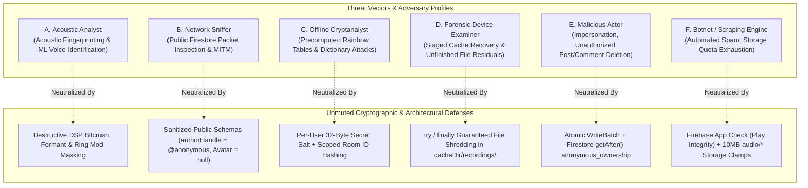
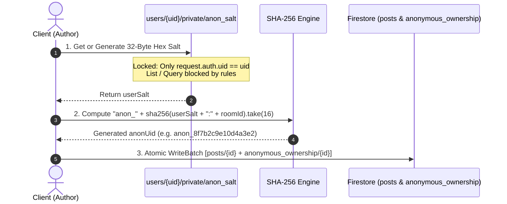
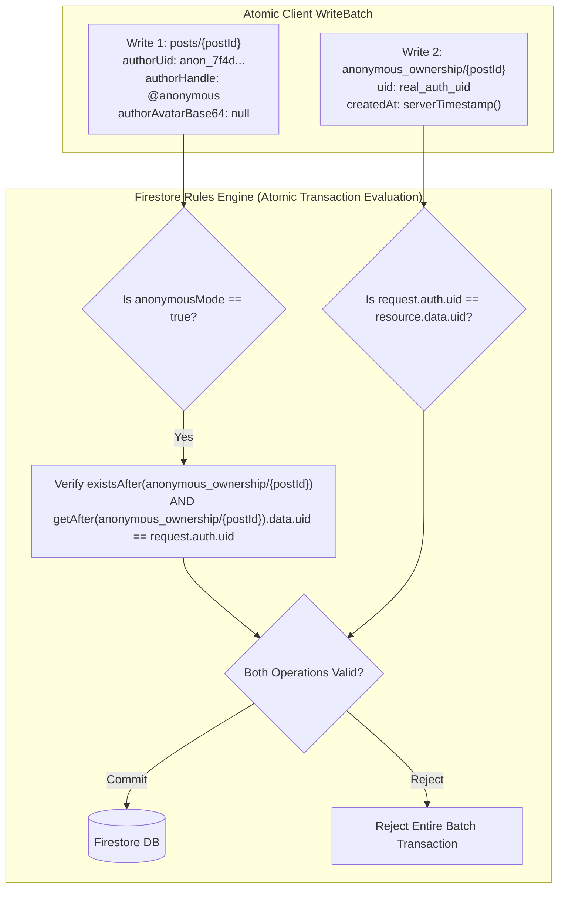

# Security Policy & Cryptographic Privacy Model

Unmuted was designed from the ground up under a **Zero-Trust, Zero-Leak** security posture. This document outlines the threat model, cryptographic isolation algorithms, on-device audio signal obfuscation, atomic database rules, and responsible disclosure procedures.

---

## Table of Contents
1. [Threat Model & Privacy Objectives](#1-threat-model--privacy-objectives)
2. [Fail-Closed On-Device Destructive Voice Masking](#2-fail-closed-on-device-destructive-voice-masking)
3. [Cryptographic Salt & Scoped Anonymous UIDs](#3-cryptographic-salt--scoped-anonymous-uids)
4. [Atomic Dual-Write & getAfter() Ownership Verification](#4-atomic-dual-write--getafter-ownership-verification)
5. [Cloud Storage & Participant-Scoped Media Isolation](#5-cloud-storage--participant-scoped-media-isolation)
6. [Firebase App Check & Device Attestation](#6-firebase-app-check--device-attestation)
7. [Deterministic Ephemeral Storage Shredding](#7-deterministic-ephemeral-storage-shredding)
8. [Vulnerability Reporting & Responsible Disclosure](#8-vulnerability-reporting--responsible-disclosure)

---

## 1. Threat Model & Privacy Objectives

Unmuted addresses six primary adversary classes and potential compromise vectors:



---

## 2. Fail-Closed On-Device Destructive Voice Masking

A common failure mode in voice privacy applications is applying pitch modulation as a playback-side metadata filter, allowing attackers to download the original unmasked audio track directly from the network.

**Unmuted implements irreversible on-device destructive signal destruction:**

1. **Destructive Digital Signal Processing Chain**:
   - **Formant & Pitch Transposition**: Transposes fundamental frequency and vocal tract resonance by $\pm 35\%$ via `SonicAudioProcessor`.
   - **Bitcrushing**: Quantizes 16-bit linear PCM down to 8-bit non-linear steps, permanently destroying high-order harmonics.
   - **Parametric Ring Modulation**: Multiplies signal samples against a synthesized 45Hz carrier wave, creating non-harmonic frequency sidebands that defeat neural speaker identification models (e.g., ECAPA-TDNN, WavLM).
2. **Fail-Closed Policy**:
   If an unusual device codec, CPU throttling, or Media3 Transformer fault causes `bakeVoiceDisguise` to throw an exception:
   - When `effectiveDisguise != VoiceDisguise.NONE`, the application **aborts upload immediately** and displays an alert:
     > *"Voice masking failed. Recording was not uploaded to protect your identity."*
   - Unmasked raw audio is **never** dispatched to cloud storage.
3. **Local Looper Enforcement**:
   Transformer baking is strictly bound to dedicated Looper threads (`HandlerThread` / `Dispatchers.Main.immediate`), preventing thread starvation or unchecked runtime crashes.

---

## 3. Cryptographic Salt & Scoped Anonymous UIDs

To prevent identity tracking across different rooms while retaining the ability to display consistent speaker personas within a single room, Unmuted uses a salted, scoped cryptographic pseudonym generator.



### 3.1 The 32-Byte Secret Salt
Each user maintains a dedicated, cryptographically secure 32-byte hex salt stored under their private user path:
```
users/{uid}/private/anon_salt
```

**Security Rules Enforcement (`firestore.rules`):**
```javascript
match /users/{uid}/private/anon_salt {
  // Only the authenticated account owner may read or generate their private salt
  allow get, create: if isSignedIn() && request.auth.uid == uid;
  // Strictly prevent listing, enumeration, or updates
  allow list, update, delete: if false;
}
```

### 3.2 Scoped Pseudonym Algorithm
The anonymous author identifier written to public documents is calculated on-device as:
```kotlin
val combined = "$userSalt:${room?.id ?: "global"}"
val anonUid = "anon_" + MessageDigest.getInstance("SHA-256")
    .digest(combined.toByteArray(Charsets.UTF_8))
    .joinToString("") { "%02x".format(it) }
    .take(16)
```

**Cryptographic Properties:**
- **Rainbow Table Resistance**: Because `userSalt` is a high-entropy secret kept in an access-restricted collection, precomputed dictionary and rainbow table attacks on `authorUid` are mathematically infeasible.
- **Cross-Room Unlinkability**: Because `roomId` is folded into the SHA-256 input string, a user's pseudonymous identifier in Room A (`anon_3d9a...`) shares no correlation with their identifier in Room B (`anon_7c1f...`) or in the global feed (`anon_a4b2...`).
- **Public Schema Sanitization**: Public post documents authored under anonymous mode write:
  - `authorUid = anonUid`
  - `authorHandle = "@anonymous"`
  - `authorName = "Anonymous Speaker"`
  - `authorAvatarBase64 = null`

---

## 4. Atomic Dual-Write & getAfter() Ownership Verification

A major technical challenge in true anonymous social platforms is ownership authorization: *how can an anonymous user edit or delete their own post without exposing their real UID in the public document?*

Unmuted solves this via **Atomic Dual-Write Batches** verified by Cloud Firestore's transactional `getAfter()` rule function.



### 4.1 Client Implementation (`FeedRepository.kt`)
```kotlin
val batch = firestore.batch()
val postRef = firestore.collection("posts").document(postId)
val ownershipRef = firestore.collection("anonymous_ownership").document(postId)

batch.set(postRef, postDocument)
batch.set(ownershipRef, hashMapOf(
    "uid" to currentUserId,
    "createdAt" to FieldValue.serverTimestamp()
))

batch.commit().await()
```

### 4.2 Security Rules Implementation (`firestore.rules`)
```javascript
// Post Creation Rule in firestore.rules
allow create: if isSignedIn() && (
  // Case A: Standard public post with verified real author UID
  (!request.resource.data.anonymousMode && request.resource.data.authorUid == request.auth.uid) ||
  // Case B: Anonymous post validated via atomic ownership document
  (request.resource.data.anonymousMode == true &&
   request.resource.data.authorHandle == "@anonymous" &&
   request.resource.data.authorAvatarBase64 == null &&
   existsAfter(/databases/$(database)/documents/anonymous_ownership/$(postId)) &&
   getAfter(/databases/$(database)/documents/anonymous_ownership/$(postId)).data.uid == request.auth.uid)
);

// Anonymous Ownership Lockout
match /anonymous_ownership/{postId} {
  allow get: if isSignedIn() && resource.data.uid == request.auth.uid;
  allow delete: if isSignedIn() && resource.data.uid == request.auth.uid;
  allow create: if isSignedIn() && request.resource.data.uid == request.auth.uid;
  allow list, update: if false; // Complete enumeration lockout
}
```

This guarantees that:
1. Nobody can forge an anonymous post without creating a verifiable ownership link in the private registry.
2. The `anonymous_ownership` collection is completely invisible to third parties (`allow list: if false`).
3. If an anonymous user decides to delete their take, the security rule performs a lookup on `anonymous_ownership/{postId}` to confirm ownership without ever having leaked the user's real UID in the public feed.

---

## 5. Cloud Storage & Participant-Scoped Media Isolation

Firebase Cloud Storage rules enforce strict content verification and participant-scoped boundary isolation (`storage.rules`):

```javascript
rules_version = '2';

service firebase.storage {
  match /b/{bucket}/o {

    function isSignedIn() {
      return request.auth != null;
    }

    function isValidAudioUpload() {
      return request.resource.size <= 10 * 1024 * 1024 &&
             request.resource.contentType.matches('audio/.*');
    }

    // Public Feed Posts & Voice Drops
    match /audio/posts/{allPaths=**} {
      allow read: if isSignedIn();
      allow write: if isSignedIn() && isValidAudioUpload();
    }

    // Direct Voice Messages: Participant-Only Isolation
    // convId format: uid1_uid2 (sorted alphabetically)
    match /audio/dms/{convId}/{msgId} {
      allow read: if isSignedIn() && convId.matches('.*' + request.auth.uid + '.*');
      allow write: if isSignedIn() &&
                      convId.matches('.*' + request.auth.uid + '.*') &&
                      isValidAudioUpload();
    }
  }
}
```

**Protective Controls:**
- **Strict Size Bounds**: Hard rejection of any payload exceeding **10 megabytes**, preventing storage exhaustion attacks.
- **MIME Type Matching**: Mandatory `audio/*` content verification.
- **Participant-Bound DMs**: Direct voice note audio files stored under `audio/dms/{convId}/{msgId}` are restricted strictly to conversation participants whose UID is embedded in the conversation path.

---

## 6. Firebase App Check & Device Attestation

To protect backend APIs, Gemini 3.8 Flash multimodal endpoints, and Firestore instances from script scraping, credential stuffing, and replay attacks, Unmuted integrates **Firebase App Check**:

- **Production Builds**: Enforces Google Play Integrity API attestation. Requests originating from modified APKs, rooted devices, or unauthorized emulators are dropped at the Firebase edge before reaching application databases.
- **Debug & Local Testing**: Configured via `AppCheckConfig.kt` to allow development through `DebugAppCheckProviderFactory` when a valid debug token is supplied via environment variable or launch intent.

---

## 7. Deterministic Ephemeral Storage Shredding

Raw audio cached on Android device flash memory poses a significant data-at-rest vulnerability if devices are lost, stolen, or examined forensically.

**Storage Shredding Safeguards:**
1. **Guaranteed Execution Blocks**: All recording, DSP transformation, and network upload methods in `FeedViewModel.kt`, `InboxViewModel.kt`, `ProfileViewModel.kt`, and `AudioEngine.kt` utilize deterministic Kotlin `try { ... } finally { ... }` wrappers:
   ```kotlin
   val rawRecordingFile = audioRecorderController.stopRecording()
   var bakedFile: File? = null
   try {
       bakedFile = audioDspProcessors.bakeVoiceDisguise(rawRecordingFile, disguise)
       val downloadUrl = audioStorageRepository.uploadAudio(bakedFile ?: rawRecordingFile)
       feedRepository.createVoicePost(...)
   } finally {
       // Deterministic unlinking of raw unmasked audio
       rawRecordingFile?.delete()
       bakedFile?.delete()
   }
   ```
2. **Automated Export Cache Cleanup**: The `AudiogramExporter` automatically scrubs the `context.cacheDir/exports/` directory prior to any new video generation, unlinking any temporary MP4 or AAC files older than 1 hour.

---

## 8. Vulnerability Reporting & Responsible Disclosure

We welcome vulnerability reports from security researchers and the open-source community. If you discover a potential security vulnerability or privacy leak in Unmuted, please disclose it responsibly.

### How to Report
- **Contact**: Submit reports directly via GitHub Security Advisories or email the maintainers at `security@unmuted.app`.
- **Response Timeline**:
  - **Initial Acknowledgment**: Within 24 hours.
  - **Triage & Reproduction**: Within 72 hours.
  - **Fix & Public Advisory**: Coordinated release within 14 days of confirmation.

**Please do NOT file public GitHub issues for sensitive security vulnerabilities.**
