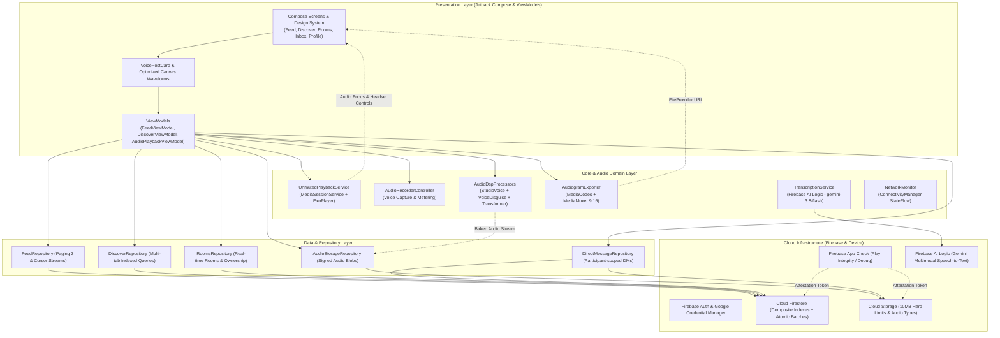
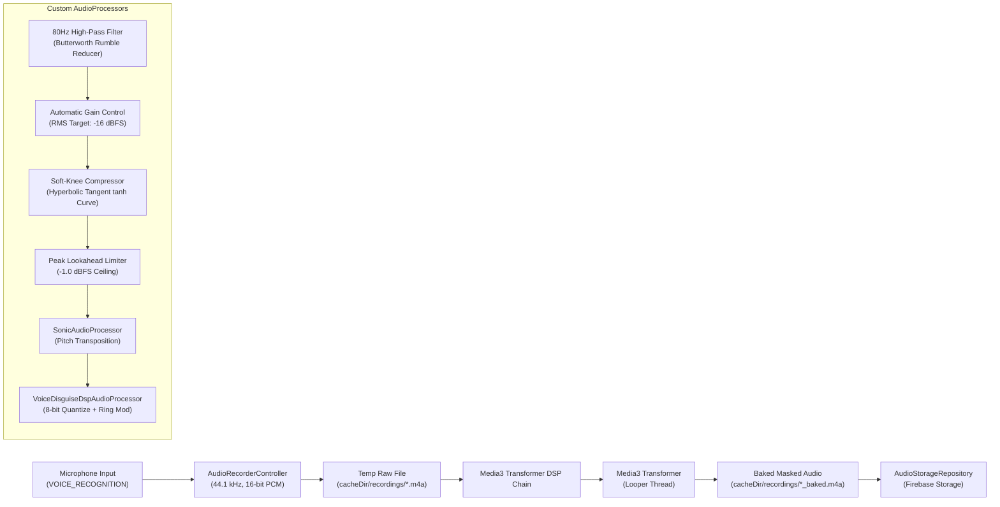
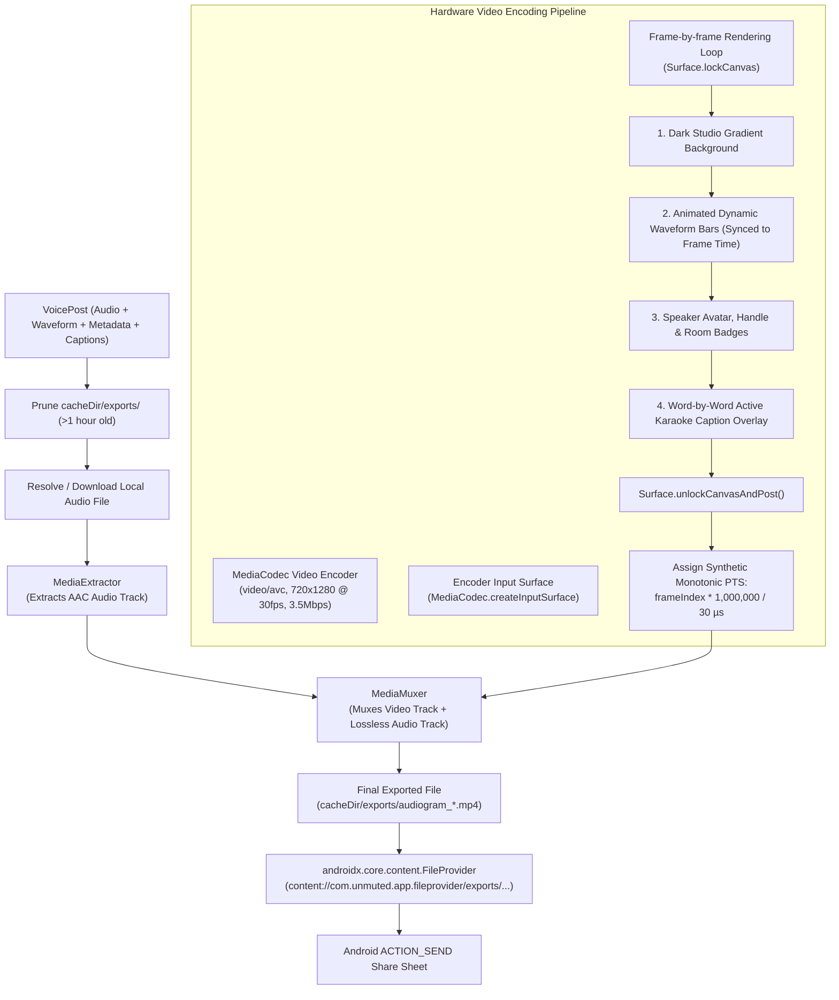
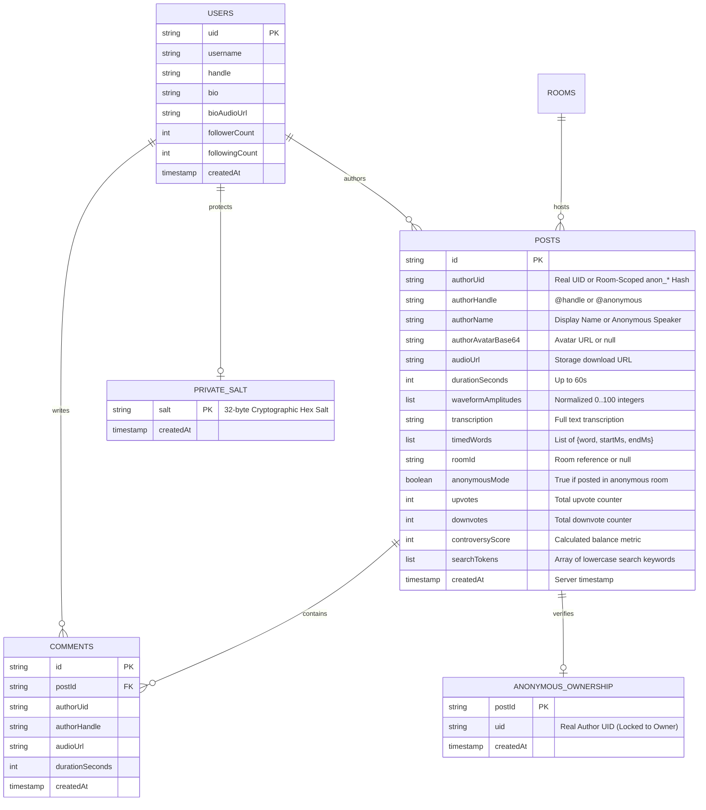
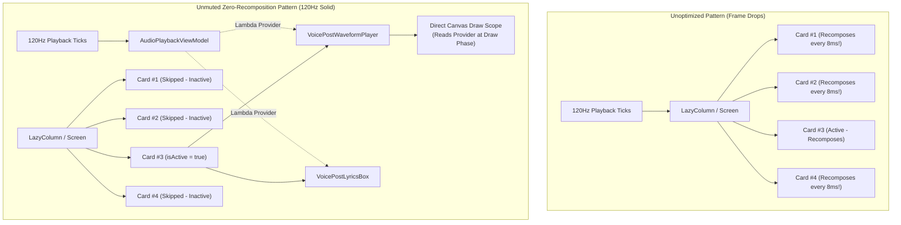

# Unmuted Architecture & Technical Specifications

This document provides a deep architectural and implementation specification of **Unmuted**, an open-source, voice-first Android social platform engineered for high-performance audio streaming, real-time synchronized karaoke captions, on-device DSP masking, and hardware-accelerated audiogram video exports.

---

## Table of Contents
1. [System Architecture & Package Structure](#1-system-architecture--package-structure)
2. [Media3 & On-Device Audio DSP Pipeline](#2-media3--on-device-audio-dsp-pipeline)
3. [Hardware-Accelerated 9:16 Audiogram Video Export](#3-hardware-accelerated-916-audiogram-video-export)
4. [Firestore Data Modeling & Composite Indexing](#4-firestore-data-modeling--composite-indexing)
5. [Discovery, Feed Ranking & Paging 3](#5-discovery-feed-ranking--paging-3)
6. [120Hz Jetpack Compose Recomposition Performance](#6-120hz-jetpack-compose-recomposition-performance)
7. [Security & Cryptographic Anonymity Guarantees](#7-security--cryptographic-anonymity-guarantees)

---

## 1. System Architecture & Package Structure

Unmuted follows clean architecture principles with strict layer boundaries: UI / Presentation (Jetpack Compose, ViewModels), Domain / Core (DSP Audio Engines, Exporters, MediaSession Services), and Data (Repositories, Firebase Firestore, Firebase Storage, Firebase AI Logic).



### Directory Structure & Package Manifest

```
app/src/main/java/com/unmuted/app/
├── core/
│   ├── audio/
│   │   ├── AudioRecorderController.kt       # AudioRecord capture, 44.1kHz PCM, live RMS amplitude stream
│   │   ├── AudioDspProcessors.kt            # StudioVoiceAudioProcessor, VoiceDisguiseDspAudioProcessor, bakeVoiceDisguise
│   │   ├── AudioPlayerManager.kt            # ExoPlayer MediaController binding, MediaItem queue, state sync
│   │   └── AudioVisualizer.kt               # Waveform normalization, downsampling, and bar calculation
│   ├── AudiogramExporter.kt                 # MediaCodec H.264 720x1280 @ 30fps + synthetic monotonic PTS + MediaMuxer
│   ├── TranscriptionService.kt              # Firebase AI Logic gemini-3.8-flash STT + monotonic timestamp fallback
│   ├── UnmutedPlaybackService.kt            # MediaSessionService, Audio Focus, BecomingNoisy, Bluetooth skip queue
│   ├── NetworkMonitor.kt                    # Real-time network state monitoring via ConnectivityManager Flow
│   └── AppCheckConfig.kt                    # Firebase App Check configuration (Play Integrity & Debug provider)
├── data/
│   ├── model/
│   │   └── Models.kt                        # VoicePost, Room, Comment, DirectMessage, PlaybackState, UserProfile
│   └── repository/
│       ├── FeedRepository.kt                # Cursor-based Paging 3, atomic anonymous posts, salted hash IDs
│       ├── DiscoverRepository.kt            # Algorithmic trending decay, controversy score, and tokenized queries
│       ├── RoomsRepository.kt               # Live room channels, topic filtering, active speaker rosters
│       ├── AudioStorageRepository.kt        # Direct upload to Firebase Storage with size & MIME validation
│       ├── ProfileRepository.kt             # User stats, pinned voice bios, follower graphs
│       └── DirectMessageRepository.kt       # Real-time encrypted/participant-scoped voice DM conversations
├── ui/
│   ├── components/
│   │   ├── post/
│   │   │   ├── VoicePostCard.kt             # Isolated 120Hz recomposition card container
│   │   │   ├── VoicePostWaveformPlayer.kt   # Hardware-accelerated Canvas scrubber and amplitude bars
│   │   │   ├── VoicePostLyricsBox.kt        # Spotify-style word/phrase synchronized karaoke lyric display
│   │   │   ├── VoicePostActionsBar.kt       # Upvote, downvote, clapback, audiogram export, and bookmark actions
│   │   │   └── VoicePostShareMenu.kt        # FileProvider intent launcher for Instagram Stories, WhatsApp, Shorts
│   │   ├── VoicePostSkeleton.kt             # Animated shimmer placeholder matching VoicePostCard layout
│   │   ├── MiniPlayerBar.kt                 # Persistent bottom playback bar with smooth progress slider
│   │   └── OfflineBanner.kt                 # Auto-animating network status indicator banner
│   ├── navigation/
│   │   └── Navigation.kt                    # NavHost configuration, route definitions, bottom nav bar bindings
│   ├── screens/
│   │   ├── feed/FeedScreen.kt               # Main feed with Material 3 PullToRefreshBox and zero-recomposition list
│   │   ├── discover/DiscoverScreen.kt       # Tabbed discovery (Trending, Controversial, Anonymous, Short Pulses)
│   │   ├── rooms/RoomsScreen.kt             # Live audio debate and discussion rooms
│   │   ├── inbox/InboxScreen.kt             # Direct voice messages and thread management
│   │   ├── composer/ComposerScreen.kt       # Voice recording studio, live waveform preview, disguise selection
│   │   └── profile/ProfileScreen.kt         # Pinned voice bio, recorded posts, and bookmark history
│   └── viewmodel/
│       ├── FeedViewModel.kt                 # Feed state, post creation, upvoting, clapback submissions
│       ├── DiscoverViewModel.kt             # Search query dispatch, tab filters, and paged results
│       ├── AudioPlaybackViewModel.kt        # Radio mode toggle, position ticks, ExoPlayer sync
│       ├── InboxViewModel.kt                # Thread listening, direct voice recording and delivery
│       └── ProfileViewModel.kt              # Profile updates, voice bio uploads, statistics
```

---

## 2. Media3 & On-Device Audio DSP Pipeline

All audio capture, manipulation, and playback in Unmuted relies on modern **AndroidX Media3 (1.5.1)** primitives. Audio is captured in high-fidelity 44.1kHz 16-bit PCM and routed through custom DSP `AudioProcessor` implementations before being multiplexed into AAC/M4A containers.



### 2.1 The Studio Voice Audio Processor (`StudioVoiceAudioProcessor`)
The `StudioVoiceAudioProcessor` operates directly on raw interleaved 16-bit PCM sample buffers (`ByteBuffer`):
1. **80Hz High-Pass Filter (HPF)**: Second-order recursive Butterworth filter that strips room rumble, microphone handling vibrations, and AC humming without thinning speech fundamentals.
2. **RMS Automatic Gain Control (AGC)**: Continuously evaluates root-mean-square signal energy across 50ms windows. Computes a dynamic gain coefficient targeting **-16 dBFS RMS**, amplifying whisper-quiet takes while attenuating excessive loudness.
3. **Soft-Knee `tanh` Compressor**: Applies an analog-modeled compression transfer function:
   $$y = \tanh(x \cdot k) / k$$
   This prevents clipping distortion, tames harsh transients, and yields warm studio-grade vocal warmth.
4. **Peak Limiter**: Hard ceiling clamp at **-1.0 dBFS** (32,440 in 16-bit signed integer space) to prevent digital inter-sample clipping upon AAC lossy encoding.

### 2.2 Voice Disguise DSP Engine (`VoiceDisguiseDspAudioProcessor`)
For anonymous rooms and privacy-sensitive commentary, identity protection is enforced at the digital signal processing level:
- **Pitch & Formant Transposition**: Powered by Media3's `SonicAudioProcessor`, altering pitch ratios by $\pm 35\%$ to defeat standard biometric voiceprint recognition models.
- **Destructive Bitcrushing**: Quantizes 16-bit linear PCM down to 8-bit non-linear steps, permanently discarding fine harmonic vocal textures.
- **Parametric Ring Modulation**: Multiplies incoming speech samples by a synthesized 45Hz carrier waveform, introducing non-harmonic sidebands that destroy vocal tract resonances.

### 2.3 Fail-Closed Execution & Threading Safety
- **Looper Thread Guarantee**: `Transformer.start()` requires invocation on a thread with an active `Looper`. Unmuted dispatches all `bakeVoiceDisguise` executions via dedicated `HandlerThread` or `Dispatchers.Main.immediate`, avoiding runtime `IllegalStateException` crashes on `Dispatchers.IO`.
- **Fail-Closed Privacy Policy**: If disguise processing fails or Transformer encounters unsupported hardware codec profiles:
  - If `effectiveDisguise != VoiceDisguise.NONE`: The pipeline **aborts immediately** with an explicit user error. Raw unmasked audio is **never** uploaded under any circumstance.
  - If `effectiveDisguise == VoiceDisguise.NONE` (Studio polish only): The pipeline safely falls back to uploading the raw recording.
- **Deterministic Storage Shredding**: All recording and baking flows are wrapped in `try { ... } finally { ... }` blocks. Both unmasked source `.m4a` files and intermediate `.pcm` buffers in `context.cacheDir/recordings/` are guaranteed to be unlinked even if the upload coroutine is canceled or encounters an uncaught network failure.

---

## 3. Hardware-Accelerated 9:16 Audiogram Video Export

Unmuted features a zero-dependency, on-device audiogram video rendering pipeline implemented in `AudiogramExporter.kt`. It produces vertical 9:16 MP4 videos ready for immediate distribution to Instagram Stories, WhatsApp Status, and YouTube Shorts.



### 3.1 MediaCodec Presentation Timestamps (PTS) & Keyframe Guarantees
1. **Monotonic Video PTS**: When rendering to a `MediaCodec` input surface via `Surface.lockCanvas(null)`, the underlying Android framework defaults to wall-clock `System.nanoTime()`. If the CPU stalls or renders faster than real-time, the resulting video plays back at erratic speeds. Unmuted enforces **synthetic monotonic PTS** directly on `BufferInfo`:
   $$\text{presentationTimeUs} = \frac{\text{encodedVideoFrameIndex} \times 1,000,000}{30}$$
   This guarantees that a 45-second audio post maps to exactly 1,350 video frames with 1:1 millisecond-accurate AV synchronization.
2. **B-Frame Suppression**: High-profile video encoders may insert bidirectional predictive frames (B-frames), which introduce presentation timestamp reordering. The encoder explicitly sets:
   ```kotlin
   format.setInteger(MediaFormat.KEY_MAX_B_FRAMES, 0)
   ```
3. **Lossless Audio Passthrough**: Rather than decoding and re-encoding the compressed AAC audio stream (which causes generational quality loss and high CPU overhead), `MediaExtractor` reads the native AAC packets from the post container and writes them directly into the `MediaMuxer` audio track.
4. **Muxer Start Sequencing**: The audio track from `MediaExtractor` is configured on `MediaMuxer` before the encoder fires `INFO_OUTPUT_FORMAT_CHANGED`. Once both tracks are registered, `muxer.start()` begins atomic multiplexing without dropped keyframes.

---

## 4. Firestore Data Modeling & Composite Indexing

Unmuted stores relational social data in Google Cloud Firestore with strict multi-tenant authorization rules.

### 4.1 Document Schema Reference



### 4.2 Composite Indexes Manifest (`firestore.indexes.json`)

To support complex social sorting at multi-million post scale without degrading query latency, Firestore requires explicit composite indexes:

| Collection | Indexed Fields | Query Purpose |
| :--- | :--- | :--- |
| `posts` | `isControversial ASC`, `anonymousMode ASC`, `createdAt DESC` | Main Feed (Non-controversial, public posts chronologically) |
| `posts` | `anonymousMode ASC`, `createdAt DESC` | Global & Anonymous Filtered Feeds |
| `posts` | `roomId ASC`, `createdAt DESC` | Dedicated Room Discussion Threads |
| `posts` | `isControversial ASC`, `controversyScore DESC`, `createdAt DESC` | Discover Tab: Trending & Controversial Debate Ranking |
| `posts` | `anonymousMode ASC`, `durationSeconds ASC`, `createdAt DESC` | Discover Tab: Short Pulses (<15s quick audio takes) |
| `posts` | `searchTokens ARRAY_CONTAINS`, `createdAt DESC` | Real-time Search Engine by hashtags & keywords |

---

## 5. Discovery, Feed Ranking & Paging 3

Feed content in Unmuted is orchestrated via Android Jetpack `Paging 3` (`AudioFeedPagingSource.kt`), supporting cursor-based Firestore pagination with low memory footprints and infinite scroll stability.

### 5.1 Algorithmic Feed Calculations

#### 1. Trending Score Decay (Hacker News Gravity Model)
Trending posts are prioritized by net engagement decayed against post age:
$$\text{Score} = \frac{U - D}{(T + 2)^{1.5}}$$
Where:
- $U$ = Upvote count
- $D$ = Downvote count
- $T$ = Elapsed time since creation in hours

#### 2. Controversy Metric
Controversial takes (high debate volume where votes are evenly split) are calculated dynamically:
$$\text{Controversy} = \begin{cases} 
(U + D) \times \left(1.0 - \frac{|U - D|}{U + D}\right), & \text{if } (U + D) \ge 5 \\
0, & \text{otherwise}
\end{cases}$$
Posts exceeding a controversy threshold are automatically flagged with `isControversial = true` and surfaced in the dedicated **Controversial** debate tab.

### 5.2 Paging Configuration
- **Page Size**: 10 posts per network page.
- **Prefetch Distance**: 3 posts ahead of the current viewport.
- **Cursor Mechanism**: Firestore `.startAfter(lastVisibleSnapshot)`.
- **Pull-To-Refresh**: Material 3 `PullToRefreshBox` invokes `pagedPosts.refresh()`, triggering parallel coroutine invalidation and smooth skeleton shimmer rendering.

---

## 6. 120Hz Jetpack Compose Recomposition Performance

Audio playback applications require continuous UI updates to display running playback position sliders, karaoke lyric word highlights, and oscillating waveform playheads. A naive implementation that passes live `playbackPositionMs` directly down a Compose hierarchy triggers full recompositions across **every visible card** in the LazyColumn at 60Hz or 120Hz, resulting in dropped frames, micro-stutters, and excessive battery drain.



### 6.1 Architectural Optimizations
1. **Zero-Recomposition Inactive Cards**:
   `VoicePostCard` does **not** take a raw timestamp primitive. It accepts:
   ```kotlin
   isActive: Boolean,
   isPlaying: Boolean,
   playbackPositionMsProvider: () -> Long
   ```
   When `isActive == false`, the card completely ignores the progress provider and renders static cached representations. Compose skips recomposition entirely for all off-duty cards.
2. **Deferred State Reads (Draw Phase Execution)**:
   The waveform scrubber reads `playbackPositionMsProvider()` inside `Modifier.drawWithContent { ... }` or directly within the `Canvas` draw phase. By reading the state provider in the **Draw Phase** rather than the **Composition Phase**, the Compose runtime skips the Recomposition and Layout phases entirely during playback ticks.
3. **Hardware-Accelerated Single-Pass Waveform Canvas**:
   Rather than rendering 40 separate Compose `Box` composables per card (which creates thousands of UI node trees in a long feed), `VoicePostWaveformPlayer` draws normalized rounded amplitude bars into a single hardware-accelerated `Canvas`:
   ```kotlin
   Canvas(modifier = Modifier.fillMaxWidth().height(48.dp)) {
       val progressRatio = (currentPositionMs.toFloat() / durationMs).coerceIn(0f, 1f)
       // Single-pass drawRoundRect executions with pre-allocated Brush shaders
   }
   ```

---

## 7. Security & Cryptographic Anonymity Guarantees

For a detailed breakdown of Unmuted's zero-leak anonymous architecture, per-user 32-byte cryptographic salts, atomic dual-writes with Firestore `getAfter()`, and App Check attestation, please refer to:

👉 **[SECURITY.md](../SECURITY.md)**
